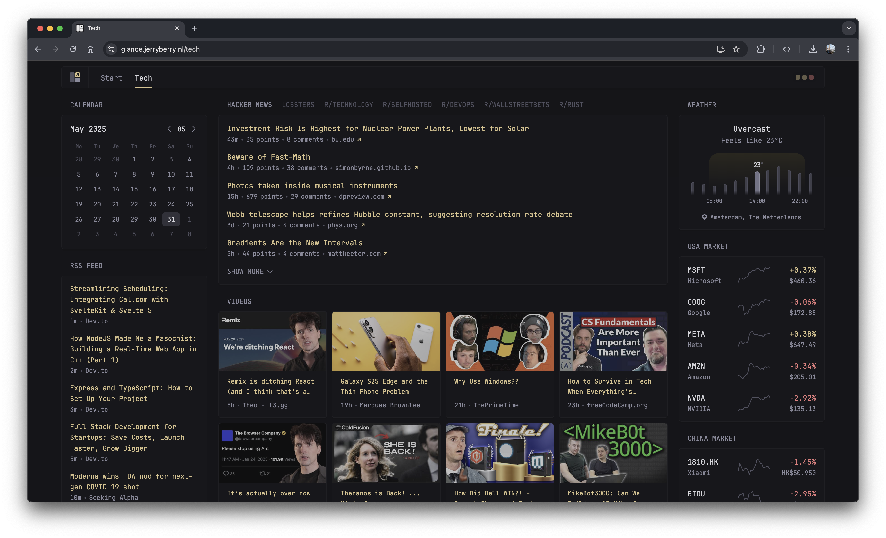
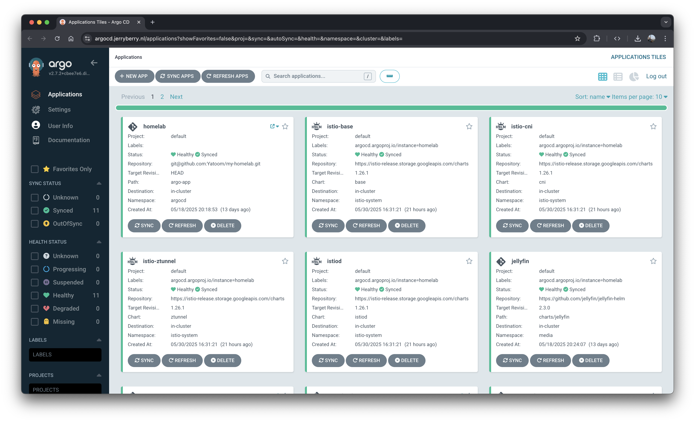
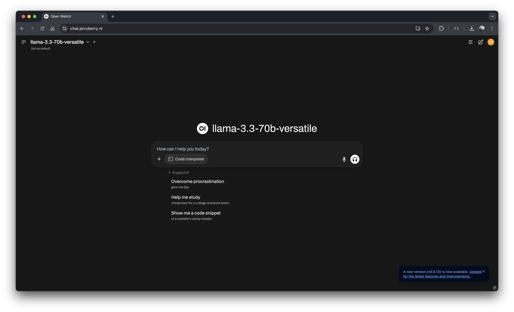
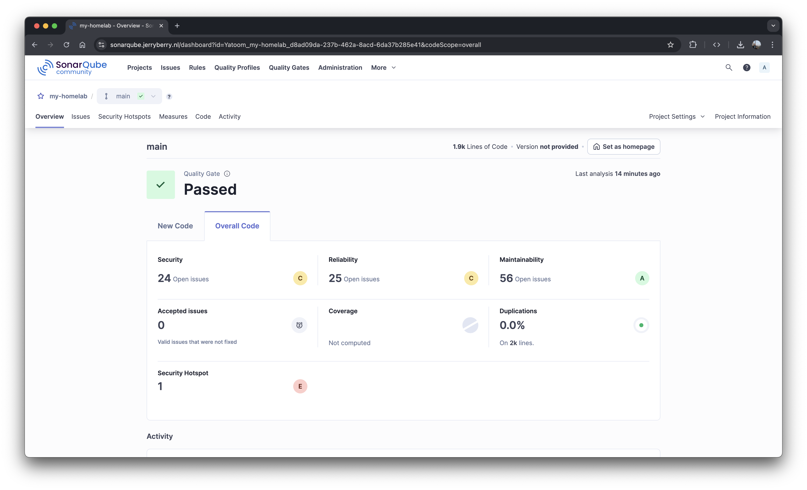
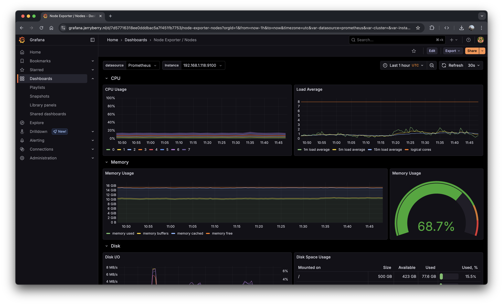
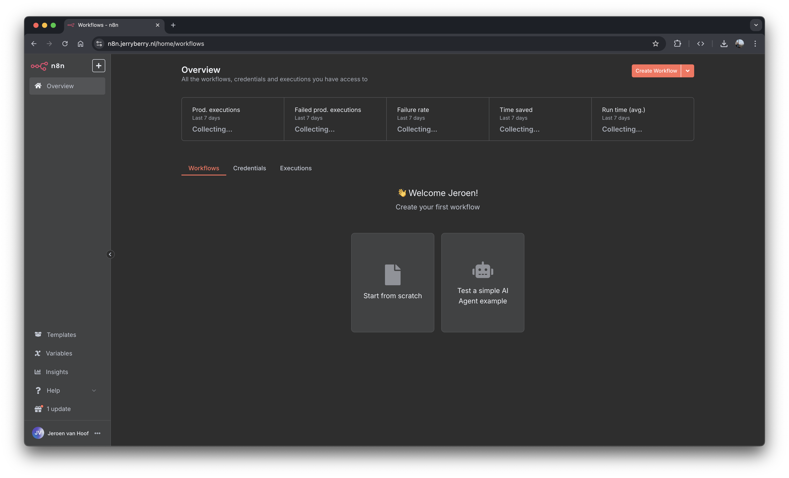
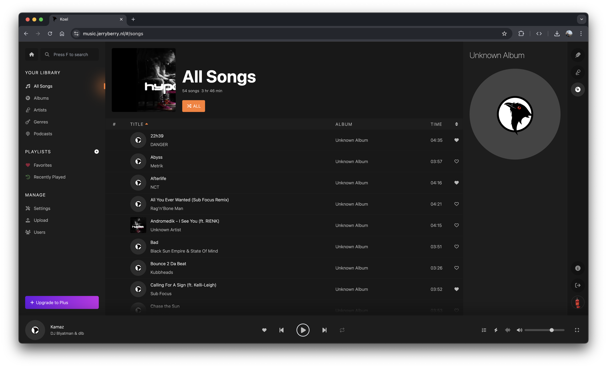
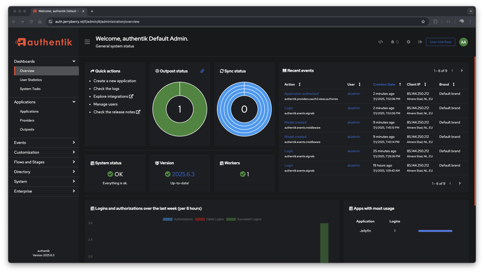

# Homelab

## Host system

Kubernetes is running on an Optiplex 3070 with an i7-9700, 16GB RAM and 1.5TB of storage.

### Microk8s

The cluster is running on microk8s. A few things have been directly enabled using `microk8s addons`.

```
addons:
  enabled:
    argocd               # (community) Argo CD is a declarative continuous deployment for Kubernetes.
    openebs              # (community) OpenEBS is the open-source storage solution for Kubernetes
    cert-manager         # (core) Cloud native certificate management
    community            # (core) The community addons repository
    dns                  # (core) CoreDNS
    ha-cluster           # (core) Configure high availability on the current node
    helm                 # (core) Helm - the package manager for Kubernetes
    helm3                # (core) Helm 3 - the package manager for Kubernetes
    hostpath-storage     # (core) Storage class; allocates storage from host directory
    ingress              # (core) Ingress controller for external access
    metrics-server       # (core) K8s Metrics Server for API access to service metrics
    observability        # (core) A lightweight observability stack for logs, traces and metrics
    storage              # (core) Alias to hostpath-storage add-on, deprecated
```

### Fixes

- Note: `microk8s enable observability --kube-prometheus-stack-version=72.7.0` reduced the memory usage by more than half. It uses a new version wit more optimization.
- Due to some issues with [Argocd](https://github.com/bitnami/charts/issues/28893#issuecomment-2306499431) I was not able to deploy mlflow via an ArgoCD app. Instead I ran the following commands:
  - `helm install mlflow oci://registry-1.docker.io/bitnamicharts/mlflow --set postgresql.auth.password=<password> --set postgresql.auth.username=jerry --set tracking.auth.password=<password>` and since I don't have a loadbalancer: `kubectl patch svc mlflow-tracking -n default -p '{"spec": {"type": "ClusterIP"}}'`
  - `helm install kagent-crds oci://ghcr.io/kagent-dev/kagent/helm/kagent-crds --version 0.9.9  --namespace kagent --create-namespace`

### Apps

- Glance 
- ArgoCD 
- Open WebUI 
- SonarQube 
- Grafana 
- N8N 
- Jellyfin 
- Koel 
- Authentik 

### Outline VPN

Outline client traffic for new keys is exposed on NodePort `30443` over both TCP and UDP; NodePort `30400` is retained for existing keys. Point `vpn.jerryberry.nl` at the public IP that reaches the MicroK8s node, and configure the router/firewall to forward external TCP and UDP port `30443` to the node's port `30443` (and `30400` if existing keys are still in use). The existing HTTPS ingress continues to use port `443`.

Create a new access key in Outline Manager. Its address should use `vpn.jerryberry.nl:30443`; add `&prefix=%16%03%01%00%C2%A8%01%01` to the end of the access-key URL, then import that URL into the Outline Client app. Keep the key private. To produce the Outline Manager setup JSON using the currently installed certificate, run `scripts/outline-manager-json.sh`. It assumes the Manager API is externally available at TCP port `60000`; pass the actual external hostname and port as arguments if they differ. The API is exposed in-cluster on NodePort `30600`; do not expose it publicly unless needed for Outline Manager.

### Secrets

Secrets are secured with [sealed-secrets](https://github.com/bitnami-labs/sealed-secrets). A secret file needs to be converted using: `kubeseal -f secret.yaml -o yaml > sealed.yaml`. `kubeseal` automatically uses the `kubectl` configuration to connect to the cluster.
